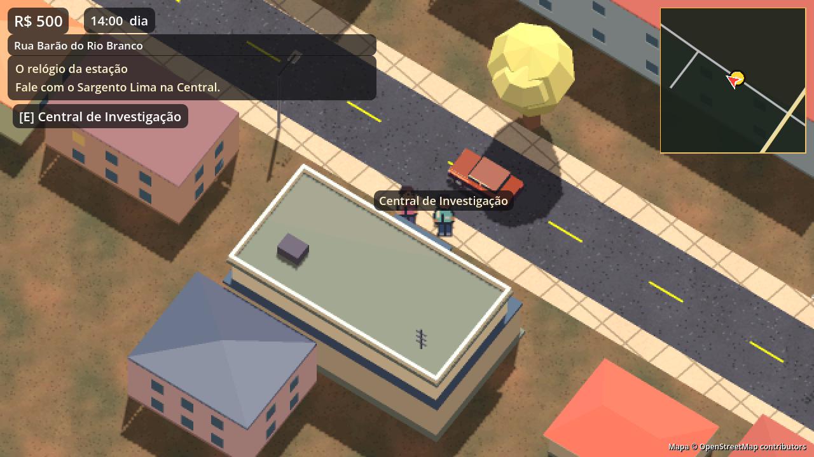

# Caso Aberto · Campo Grande

Jogo de investigação em Campo Grande (MS), com cidade isométrica, renderização pixelada e casos ficcionais.

## Jogar

[**Jogar no navegador ou no celular**](https://contato673.github.io/CASO-ABERTO-GPT/)

- [Windows](versoes/Caso-Aberto-Windows.zip) — extraia e execute **Caso Aberto - Campo Grande.exe**.
- [Navegador](versoes/Caso-Aberto-Web.zip) — extraia e sirva a pasta por HTTP em localhost ou HTTPS na hospedagem.
- [Revisão técnica e controles](REVISAO.md).
- [Capturas de teste](testes-visuais/).

Use **W/A/S/D** ou as setas para dirigir, **F** para sair do carro ou entrar nele, **E** para interagir e **C** para abrir o caderno. O primeiro caso envolve o Museu dos Trabalhadores Ferroviários, a Feira Central e o Relógio da 14 de Julho. No celular, use o botão **Descer** com o veículo parado.

## Editar no Godot

1. Com o projeto original em mãos, copie a pasta **assets/pack/** para os mesmos caminhos neste projeto. Os modelos de terceiros devem ser obtidos da sua cópia original. As licenças do projeto ficam em **assets/LICENSES/**.
2. Importe **project.godot** no Godot 4.7.2. Pressione **F5** para testar.
3. Os modelos autorais estão em **assets/cidade/**. O gerador em **scripts/blender/cidade_cg.py** pode regenerá-los com Blender 5.2 e Python.
4. Para atualizar as versões jogáveis, use os presets **Windows** e **Web** do Godot e substitua os ZIPs correspondentes em **versoes/**.

Dados cartográficos © [OpenStreetMap contributors](https://www.openstreetmap.org/copyright), sob ODbL.
